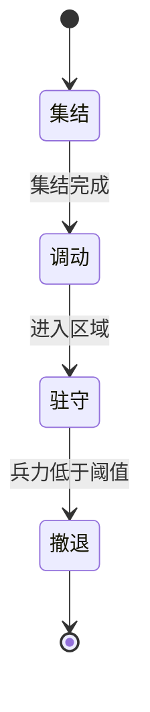
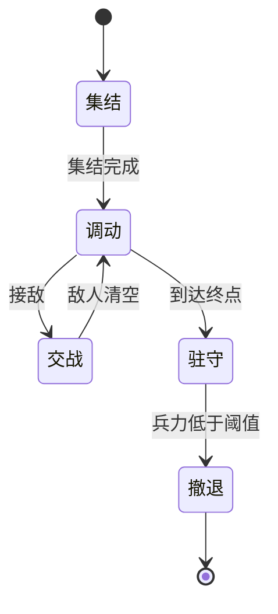

## 分层架构

### L1 群体层
职责：直接控制单位集群移动
实现方式：采用Couzin算法，用不同的“力”驱动每个单位移动

### L2 小队层
#### 职责：
1. 管理并执行小队目标，包括 驻守、进攻推进
2. 控制小队L1层couzin算法参数（每个小队的Couzin算法参数可以互相独立设置）

#### 实现方式：
##### 小队目标
小队拥有多种目标，每种目标拥有不同的状态机，通过不同的状态实现每个目标阶段要做的事情；

目标种类：
1. 调动并驻守区域
2. 进攻推进


状态机设计：

#### 三条公共规则

| 规则                 | 说明                                                  |
| ------------------ | --------------------------------------------------- |
| **状态离散，输出连续**      | 状态判定 2~5 Hz；输出的力参数在 0.3 s 内插值过渡，L1 层看不到阶跃           |
| **每个状态只输出两样东西**    | ① 命令力（点 / 区域约束）② Couzin 参数组（力权重、力区域半径）。**不输出位置、速度** |
| **所有转移带滞回 + 最小驻留** | 进入阈值与退出阈值不同；每个状态至少停留 0.5 s                          |

兵力定义：`兵力 = 当前存活单位数 / 命令下达时的单位数`

---

#### 如何判定「集结完成」★

**不能用固定半径。** 部队摊开的直径由 `r₁ / w_sep / w_coh` 的平衡决定，和 `r₃` 没有因果关系。
用 `1.5 × r₃` 这类判据有两个后果：参数一变就失效；参数偏向松散时会**永远达不到**，集结流程死锁。

正确做法是判定**收敛**，而不是判定**距离**。三个条件同时成立：

**① 紧凑度（形状已经堆实）**

```
Rg    = sqrt( mean |pᵢ − c|² )            // 回转半径，c 为小队质心
d_nn  = mean( 每个单位到最近队友的距离 )   // 平均最近邻间距
k     = Rg / (d_nn × √N)                  // 无量纲紧凑度
```

| 形态 | k（N≈48，实测参考） |
|---|---|
| 完美圆盘 / 六方堆积 | ≈ 0.40 |
| 松散一些的团 | 0.45 ~ 0.55 |
| 拉成一条 | ≈ 2.0 |
| 裂成两团 | > 2 |

**判据：`k < 0.55`** —— 与 `r₁ / r₃ / 力权重` 的取值无关。

**② 队形稳定（不再变化）**

每 0.5 s 存一次**相对质心**的位置快照，比较：

```
Q = mean | (pᵢ(t) − c(t)) − (pᵢ(t−ΔT) − c(t−ΔT)) |
```

**判据：`Q / d_nn < 0.15`**（同样无量纲；减去质心 → 平移不变，整体缓慢移动不算"还在集结"）

**③ 超时兜底（必须有）**

```
超过 6 s 仍未满足 ①② → 强制判定完成，并在 UI 标记「未完全集结」
```

没有这一条，极端参数下集结会卡死。

> **实测记录**（48 单位 / 队，原型默认参数）：
> 正常收拢后 `k = 0.415 ~ 0.432`，与理论值 0.40 吻合，`k < 0.55` 有充足余量。
> 但被地图边界挤压时队形会沿墙拉长，实测 `k = 1.09` —— **此时形态判据永远不满足**。
> 这正是超时兜底不可省略的原因：它兜的不是"参数调坏了"，而是"地形不允许"。

**为什么不用"平均速度"判定**：停滞补力会让速度永远不低于阈值，且部队整体平移时速度很高但队形早已稳定。

**判据按状态性质选择，不要混用**：

| 转移 | 用哪类判据 | 原因 |
|---|---|---|
| 集结 → 调动 | **形状收敛**（①②） | 集结是"收拢好了"，不是"到了某坐标" |
| 调动 → 驻守 | **位置到达**（比例入区） | 驻守本身就是位置语义 |
| 调动 → 交战 | **位置**（敌方进入交战半径） | 同上 |

实现代价：每支小队 `O(m²)` 求 `d_nn`（m 为队内单位数），2~5 Hz 执行，可忽略。

---

#### 目标一：调动并驻守区域



**各状态的输出**

| 状态     | 命令力                                                                            | Couzin 参数                         |
| ------ | ------------------------------------------------------------------------------ | --------------------------------- |
| **集结** | 无（或指向集结点的弱吸引，强度 ≤ 0.2）                                                         | `w_coh ↑`、`w_sep ↓`、`w_cmd ↓`     |
| **调动** | 点场：指向目标区域中心；距中心 < 0.8R 时强度线性衰减至 0                                              | 行军档：`w_ali` 高、`w_coh` 中、`w_sep` 中 |
| **驻守** | 区域场（SDF 软墙）：`d = sdf(p)`，仅在 `d > 0` 时出力，强度 `= smoothstep(0, margin, d)`；区域内为 0 | `w_coh ↑`、`w_sep` 中、`w_cmd` 低     |
| **撤退** | 点场：指向撤退点                                                                       | `w_sep ↑`、`w_coh ↓↓`、`w_cmd` 高    |

**转移条件**

| 转移      | 条件                                       | 滞回 / 驻留              |
| ------- | ---------------------------------------- | -------------------- |
| 集结 → 调动 | 形状收敛：`k < 0.55` 且 `Q / d_nn < 0.15`（见上节） | 持续 0.5 s；超时 6 s 强制完成 |
| 调动 → 驻守 | ≥ 80% 单位进入目标区域                           | 持续 0.5 s             |
| 驻守 → 撤退 | 兵力 < 撤退阈值（建议 50%，可调）                     | 持续 1.0 s             |

---

#### 目标二：进攻推进



**各状态的输出**

| 状态     | 命令力                                                   | Couzin 参数                                               |
| ------ | ----------------------------------------------------- | ------------------------------------------------------- |
| **集结** | 同目标一                                                  | 同目标一                                                    |
| **调动** | 推进线场：单位投影到推进横线，追"自己正前方那一点"；命令点沿路径前进，速度由部队落后距离**反馈调速** | 行军档                                                     |
| **交战** | 指向当前敌方小队重心（或最近敌人）                                     | `w_pursue ↑`、`w_sep ↑`（自动形成包抄）、`rangeKeep` 生效、`w_coh ↓` |
| **驻守** | 区域场（SDF 软墙）                                           | `w_coh ↑`                                               |
| **撤退** | 同目标一                                                  | 同目标一                                                    |

**转移条件**

| 转移 | 条件 | 滞回 / 驻留 |
|---|---|---|
| 集结 → 调动 | 形状收敛：`k < 0.55` 且 `Q / d_nn < 0.15`（同上节） | 0.5 s；超时 6 s 强制完成 |
| 调动 → 交战 | 交战半径内敌方单位数 ≥ 3（避免被单个侦察兵牵走） | 0.3 s |
| 交战 → 调动 | 交战半径内敌方存活数 = 0 | 1.0 s |
| 调动 → 驻守 | 到达路径终点，≥ 80% 单位进入终点区域 | 0.5 s |
| 驻守 → 撤退 | 兵力 < 撤退阈值 | 1.0 s |

**关键实现约束：`调动 ⇄ 交战` 必须保留推进进度**

```
交战期间冻结 pathProgress（不推进、不回退）
交战结束 → 从原 pathProgress 继续推进
```

否则打完一仗部队会退回到路径起点，或者原地重头开始推。这是这条双向边**唯一**容易写错的地方。

---

#### 待确认的边

上面两张图严格按你给出的流程画。以下三条是流程里没覆盖、但实现时会立刻撞上的情况，需要你确认：

| # | 情况 | 当前流程的表现 | 建议 |
|---|---|---|---|
| 1 | **进攻推进**中兵力跌破阈值 | 没有撤退边，部队会带残兵继续推 | 是否也加 `调动/交战 → 撤退` |
| 2 | **驻守**中遭到攻击 | 停在驻守，不会交战 | 是否加 `驻守 ⇄ 交战`（守阵地并还击） |
| 3 | 交战结束但兵力已低于阈值 | 回到调动继续推进 | 是否应直接转撤退 |

另外，`交战` 目前只由"敌人出现"触发。如果后续要区分**追击**与**原地还击**，才需要给交战态再拆子状态 —— 按现在的流程还不需要。


小队如何与L1群体层交互？
1. 控制小队 力权重、力区域范围等couzin算法参数，以实现不同的群体性行为
2. 控制“命令力”以直接操作单位移动方向

### L3 指挥层
职责：
1. 小队目标制定
2. 小队组建，编制管理


