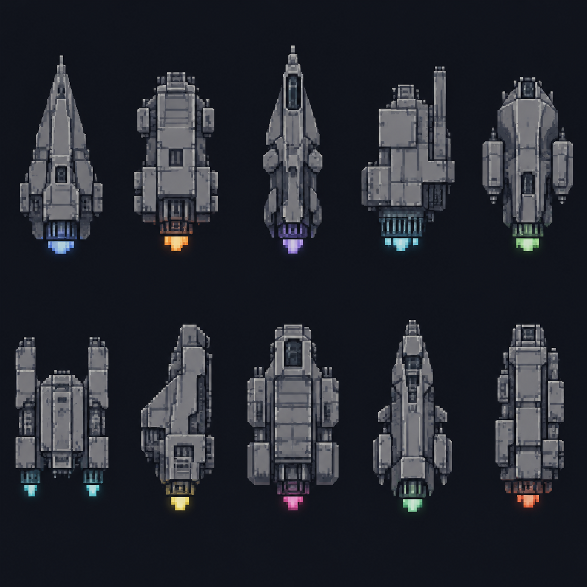
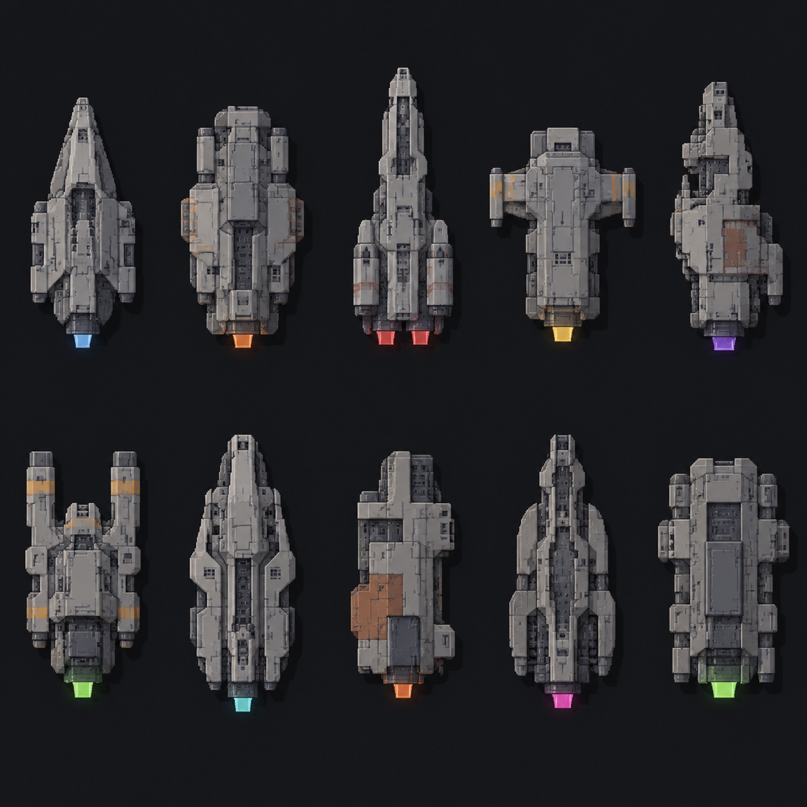
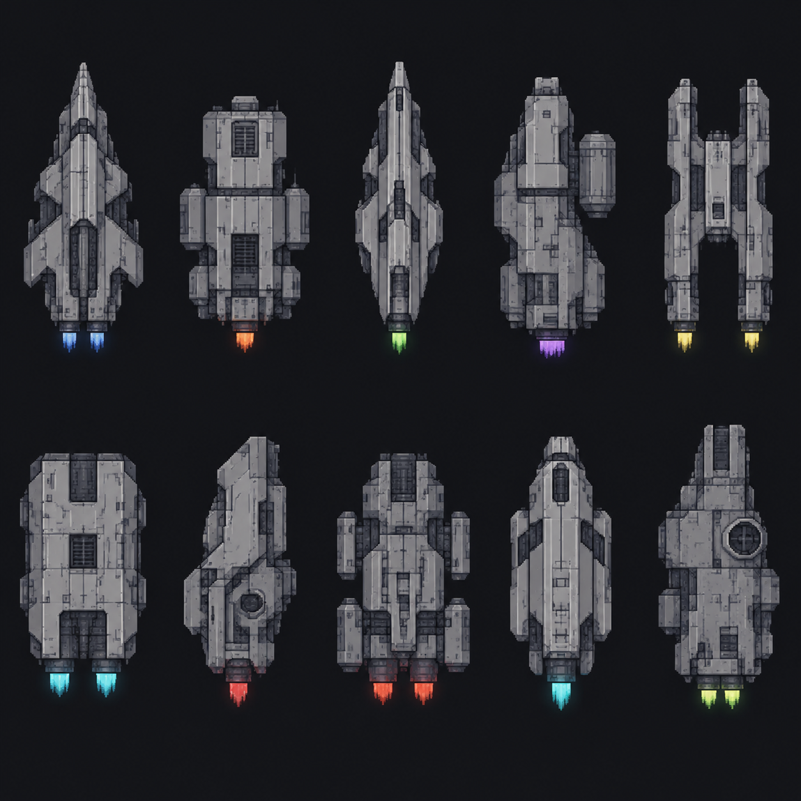

# 战舰概念图 · 生成记录

像素风星际战舰的概念设计稿。所有图为 `gpt-image-2` 生成，单张 1024×1024。

---

## Set A — 护卫舰 10 艘（采用）



**文件**：`frigate-set-A.png`
**生成时间**：2026-11-07
**定位**：护卫舰级，俯视，2×5 排列

### 提示词

```text
Pixel art ship sheet: ten different frigate-class sci-fi spaceships, top-down view, arranged in two rows of five on a flat dark background.

Design them in the spirit of the ships from Starsector, FTL and Stellaris: small, cramped, utilitarian, industrial. Each one a distinctly different hull with its own readable silhouette and proportions — some slim and pointed, some blunt and boxy, some with nacelles or outriggers, some asymmetric or patchwork. No aircraft wings.

Plain hull plating, no turrets and no visible weapon mount positions. Crisp pixel art, hard edges, limited grey palette with one engine glow colour per ship.
```

### 为什么这版有效

关键在于**放弃了"矩形舰体"这条硬约束**。加矩形约束时，模型只能靠装甲板纹理区分十艘舰，剪影全部坍缩成同一个 3.5:1 的长条。放开后，剪影自由度回到"首部形状 / 长宽比 / 侧向挂载 / 对称性"四个轴上，才产生出可辨识的十种轮廓。

### 已知问题

1. **明暗不一致**：1、2 号是正面偏上光照，4、7 号是左上光照。
2. **立面结构超出舰体投影**：4 号的高塔、6 号的双竖臂，严格俯视下不该出现，旋转时会抖动。

---

## Set B — 护卫舰 10 艘（在 A 基础上优化）



**文件**：`frigate-set-B.png`
**生成时间**：2026-11-07
**定位**：与 A 同规格；针对 A 的两个已知问题做了提示词修复

### 提示词

```text
Pixel art ship sheet: ten different frigate-class sci-fi spaceships, top-down view, arranged in two rows of five on a flat dark background.

Design them in the spirit of the ships from Starsector, FTL and Stellaris: small, cramped, utilitarian, industrial. Each one a distinctly different hull with its own readable silhouette and proportions — some slim and pointed, some blunt and boxy, some with flanking nacelles or outriggers, some asymmetric or patchwork. No aircraft wings.

Every ship is drawn as a true plan view from directly overhead: all structure stays inside the hull outline, no tall masts, spires, antennae or towers sticking out, so each sprite can be rotated freely and still read correctly.

Uniform lighting across the whole sheet: one hard light source from the upper left, shadow on the lower right, so all ten read as one set drawn by one artist. All hulls at a consistent frigate scale with similar overall mass.

Plain hull plating, no turrets and no visible weapon mount positions. Crisp pixel art, hard edges, limited grey palette with one engine glow colour per ship.
```

只在 A 的提示词上加了**两段**：统一左上光源、严格俯视不留立面结构。其余一字未动。

### 相对 A 的变化

| 维度 | A | B |
|---|---|---|
| 光照 | 各舰不同，像拼图 | 已统一，左上一束硬光 |
| 材质 | 干净的军灰 | 多了锈斑与磨损色块，更"用过" |
| 俯视纯度 | 立面外露（4 号高塔、6 号双竖臂） | **约束反而催生了新的外露侧立面**，多艘呈 3/4 观感 |
| 剪影辨识度 | 强 | 略弱，细部变碎、外形更圆润 |

B 解决了光照，但"严格俯视"这条没吃住——模型把"结构不要超出轮廓"理解成了"把侧立面画出来"，于是好几艘出现了俯视视角下不该看到的舰体侧面。

### 结论

两套各有取舍，**A 的剪影更适合进游戏**（缩到 32×32 仍可分辨），**B 的光照与旧化更适合做整体基调参考**。

---

## Set C — 护卫舰 10 艘（A 提示词原文重跑）



**文件**：`frigate-set-C.png`
**生成时间**：2026-11-07
**定位**：提示词与 Set A **完全逐字相同**，没有增加任何约束

### 提示词

与 Set A 一字不差（见上方 Set A 提示词块）。

### 为什么 B 掉了像素风

B 加的那两段——"统一左上硬光"和"严格俯视、结构不超出轮廓"——本质是在要求**更多可解释的几何细节**（侧面转折、投影关系）。模型于是把算力放到了"把侧立面画对"上，像素网格随之被填满，风格从"块面像素"退化成"高细节等距渲染"。

像素风是**信息密度**的产物：一块颜色代表一整块结构。提示词一变长，模型就倾向于用更多颜色块描述同一块结构，风格自然崩掉。

**这条经验值得记下来：像素风的提示词要短。细节留到后处理阶段，不要靠提示词索要。**

### 本版观察

- 像素风回来了：硬边、平涂、无渐变、无抗锯齿
- 十种剪影：尖箭 / 钝箱 / 水滴 / 单体加侧舱 / U 形双臂 / 宽板 / 斜切不对称 / 四角舱 / 药丸形 / 带环形传感器的拼装舰
- 仍有"竖向圆头板"这个母题重复（第 3、8、9 号），缩到 32×32 后这三艘会接近
- 舰体偏亮，比 A 少一点层次
